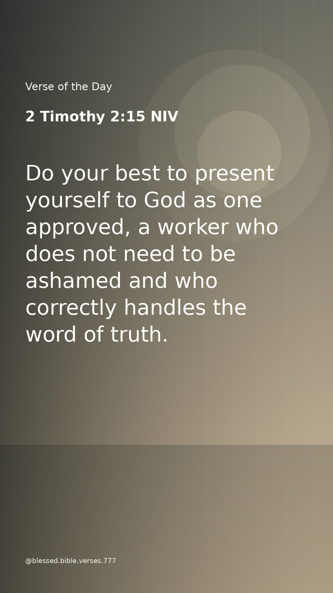
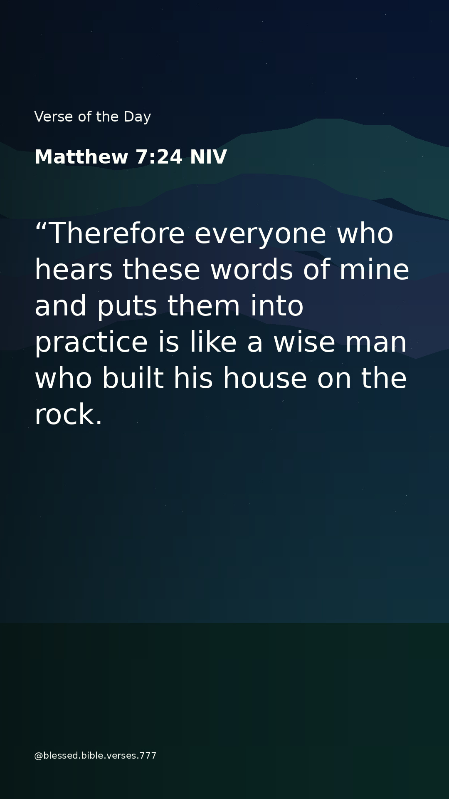

# Let your light shine 🤍

> Let your light so shine before men, that they may see your good works, and glorify your Father which is in heaven.
>
> — Matthew 5:16 · KJV

*So Blessed*

## Explore the visual collection

A quiet collection of faith-inspired images and visual reflections. Browse the artwork at your own pace.

**[Open the visual archive](GALLERY.md)** to browse the dated collection of existing image posts and visual stories in one place. You can also browse the [image posts](posts/) or [visual stories](stories/) folders directly.

### Recent public pieces

A glimpse of the existing collection. Select an image to view the original.

| Image posts | Visual stories |
|:---:|:---:|
|  |  |
|  |  |

This is a simple public image archive. The artwork is available to view here without a separate app, account, or subscription. Public availability does not automatically grant permission to reproduce or redistribute the images.
